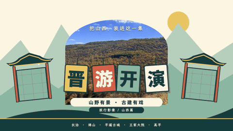

# 旅途开演 · Trip on Show

用于制作旅行综艺与文旅宣传视频的 AI Skill。融合群像陪伴、任务挑战，以及海外旅行人文、美食与路线叙事，覆盖导演策划、AI 素材生成、综艺剪辑、字幕花字、地图动效、声音设计和成片检查。

## 安装

### 方式一：跟你的 agent 说（推荐）

```text
帮我安装 trip-on-show 这个 skill（github.com/dqzboy/trip-on-show），装好后跑一遍 demo
```

### 方式二：一行命令

```bash
npx skills add dqzboy/trip-on-show
```

### 手动安装（可选）

将仓库克隆到 Codex 的 Skills 目录：

**macOS / Linux：**

```bash
git clone https://github.com/dqzboy/trip-on-show.git ~/.codex/skills/trip-on-show
```

**Windows（PowerShell）：**

```powershell
git clone https://github.com/dqzboy/trip-on-show.git "$env:USERPROFILE\.codex\skills\trip-on-show"
```

也可以在本仓库点击 **Code → Download ZIP**，解压后将文件夹重命名为 `trip-on-show`，放入上述 Skills 目录。如设置了 `CODEX_HOME`，则放入 `$CODEX_HOME/skills/`。

确认目录结构为 `skills/trip-on-show/SKILL.md`，然后新建 Codex 对话使用；若未识别，重启 Codex 后重试。

## 成片预览（GIF）

以下为两段成片的 GIF 预览（由原始 60 秒全高清 MP4 截取高光片段、降分辨率与帧率后生成，GIF 不含音频）：

**山西五站 · 成片（竖屏）**


**晋游开演 · Trip on Show v2（横屏）**




## 使用

完整制作默认要求逐素材分析、逐镜头精确入出点、覆盖全片的逐秒审阅表，以及精确到帧的图层/关键帧和检查记录，详见 [逐帧制作规范](references/frame-accurate-production.md)。入口保持可读，详细操作在 references 中，均属于此 Skill。AI 根据本片内容自主设计原创插画和包装，不固定复用参考中的小车、浅色信息条或某套贴纸。

在请求中输入“使用 trip-on-show”或 `$trip-on-show`，并提供素材或素材路径、目标时长和画幅。若未说明画幅（竖屏/横屏），Skill 会先向你确认后再开始制作。默认采用自制旅行综艺风格（`full-variety`）：节目包装、人物定格抠像、情绪贴纸、吐槽花字、漫画强调、剪贴路线和同步音效，无需每次重复指定强综艺。需要安静游记、人文纪录或简洁宣传风格时另行说明。

**剪辑已有素材：**

```text
使用 $trip-on-show，把我提供的旅行素材剪成 90 秒竖屏视频。
以温暖群像为主，加入任务挑战、轻松花字和路线地图，保留人物原声。
完成剪辑、动效、混音、预览修正和最终导出，并交付可编辑工程。
```

**制作强综艺包装的旅行 Vlog：**

```text
使用 $trip-on-show，把我的素材剪成自制旅行综艺风格。
采用 full-variety 包装：原创节目角标和章节牌，结合人物定格抠像、
情绪贴纸、吐槽花字、漫画强调、剪贴路线页与同步音效。
按实际事件选择效果，先完成一个带声音的代表样段，再扩展全片。
交付实际视频和可编辑工程。
```

效果配方见 [强综艺包装规范](references/variety-effects.md)，具体资产切层、路径/部件动画、描线、遮罩、物件合成与接镜见 [动画与插画实作](references/animation-playbook.md)。默认强综艺交付需要本片专属的实际美术和可见动作关系；照片轻推近、固定照片卡与描边字不能单独作为完成依据。先完成带声音代表样段，再扩展全片，并分别验收视觉完成度和工程技术。

**制作 AI 旅行短片：**

```text
使用 $trip-on-show，制作一支 60 秒的虚构海边旅行短片。
三位朋友寻找日落前的晚餐，融合轻松任务、美食人文和目的地宣传感。
先完成分镜和逐镜生成提示词，再根据当前可用工具推进制作。
```

**只需要策划方案：**

```text
使用 $trip-on-show，为我的旅行短片设计故事、分镜、花字和声音方案。
暂不生成素材或渲染视频。
```

实际生成与导出需要相应的视频工具、素材及服务权限。Skill 本身不包含视频引擎或付费服务。若希望参考具体节目片段，请提供可访问的参考视频或片段信息。

开头制作要求见 [综艺片头、主题场景与正片交接](references/variety-openings.md)。文档只保留通用风格要求与原创制作方法。

## 许可证

本项目基于 [MIT License](LICENSE) 开源。详见仓库根目录的 [LICENSE](LICENSE) 文件。
